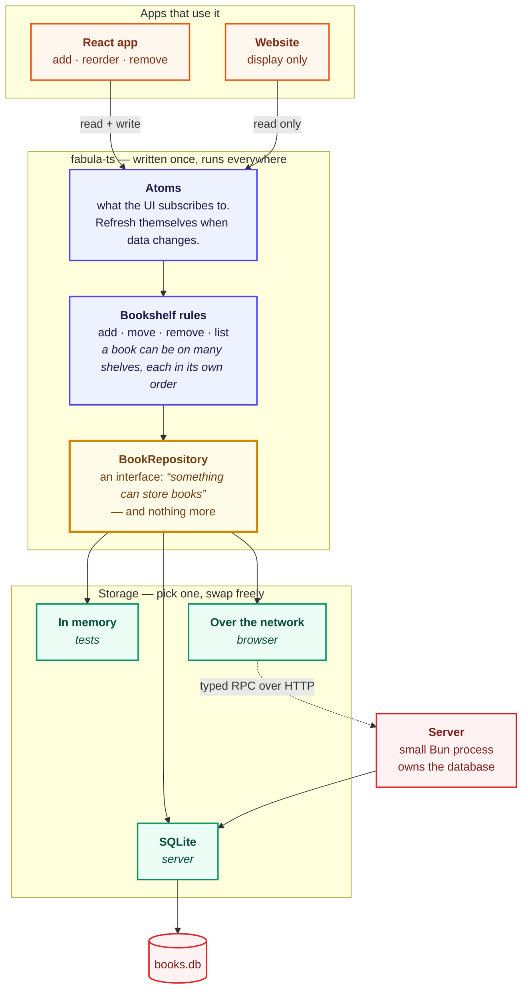
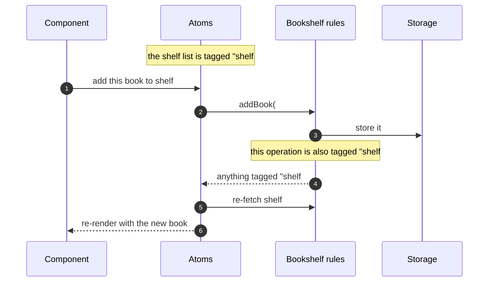

# fabula

**A bookshelf you can embed in any TypeScript app.**

Store books, organise them onto shelves, keep them in the order you arranged them.

It ships as a *library*, not an app — so the same code runs in a browser talking to a
server, on a server talking straight to SQLite, or entirely in memory inside a test.
Built with [Effect](https://effect.website). No React dependency; React only shows up
when an app decides to render a shelf.

---

## The big picture

---

How that self-refresh works

Reads and writes carry the same tags, so a write automatically refreshes every read it
affected. Nothing has to remember to do it by hand.

---

## Packages

One package, `fabula-ts`, with `effect` as its only peer dependency and no dependencies
at all. Import only what you need:

| Module | Contents |
| --- | --- |
| `fabula-ts` | model, errors, ordering, the repository interface, the rules |
| `fabula-ts/sql` | the SQL implementation, written against `SqlClient` — no database driver |
| `fabula-ts/atoms` | `makeBookshelfAtoms` |
| `fabula-ts/rpc` | the wire contract |
| `fabula-ts/testing` | the in-memory implementation |

A browser app importing `fabula-ts` never resolves `fabula-ts/sql`, so server-only code
stays out of the build by module resolution. `sideEffects: false` strips unused exports
on top of that.

`apps/server` stays private and picks the driver layer — `@effect/sql-sqlite-bun` today,
Postgres or libSQL later, without the library changing.
