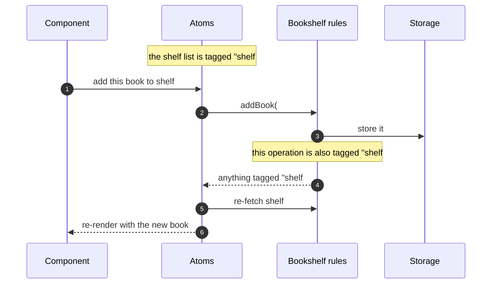

# fabula

**A bookshelf you can embed in any TypeScript app.**

Store books, organise them onto shelves, keep them in the order you arranged them.

It ships as a *library*, not an app — so the same code runs in a browser talking to a
server, on a server talking straight to SQLite, or entirely in memory inside a test.
Built with [Effect](https://effect.website). No React dependency; React only shows up
when an app decides to render a shelf.

---

## The big picture


**Read it in one sentence:** the blue box is written once and never changes; the green
boxes are interchangeable, so the same shelf UI works against a server, a local file, or
nothing at all.

That yellow interface is the whole design. If the UI called the server directly, the
library would only work in one setup — with the interface in between, a test swaps in a
fake, a browser swaps in the network, a server swaps in SQLite, and nothing above the
line notices.

---

## What you would actually write

```tsx
function AddBookForm({ shelfId }: { shelfId: ShelfId }) {
  const [result, addBook] = useAtom(atoms.addBook)

  return (
    <form onSubmit={() => addBook({ shelfId, title, authors })}>
      <button disabled={result._tag === "Loading"}>Add</button>
      {result._tag === "Failure" && <Error cause={result.cause} />}
    </form>
  )
}
```

No loading state to declare, no error handling to wire up, and **no refetching the
shelf** — the list updates itself, because reads and writes share invalidation tags
inside the library.

<details>
<summary>How that self-refresh works</summary>



Reads and writes carry the same tags, so a write automatically refreshes every read it
affected. Nothing has to remember to do it by hand.
</details>

---

## Design decisions worth arguing about

The reasoning behind each, and what it was chosen over, is in [`docs/adr/`](docs/adr/).

| Question | Answer | Why |
| --- | --- | --- |
| Can a book be on two shelves? | Yes — each shelf keeps its own order | "Currently Reading" *and* "Sci-Fi" is the normal case, not an edge case. |
| How is order stored? | A sort key per book, not positions 1..n | Moving a book updates one row. Works identically in SQLite, Postgres, or a Notion property. |
| Can apps add fields to `Book`? | No — the schema is fixed | Making it customisable puts a type parameter in every function signature. Apps keep extra data in their own table, keyed by book id. |
| Who owns the database? | The app, not the library | A library that hardcodes its storage can only be used once. |
| Browser to server | Typed RPC, contract shared by import | Both sides are TypeScript, so they share one definition and cannot drift. |
| Accounts? | None. Two tokens: read, and read-write | One user. A user id threaded everywhere would be ceremony with no payoff today. |

---

## Packages

| Package | Published | Needs |
| --- | --- | --- |
| `@fabula-ts/core` | yes | `effect` only — safe in a browser |
| `@fabula-ts/sql` | yes | core + SQLite — server-side only |
| `apps/server` | no | core + sql |

## Development

```sh
bun install
bun run test      # vitest, with Effect's test helpers
bun run build     # tsdown; type declarations built by tsc
```

Effect is pinned at `4.0.0-rc.112`. `.vendor/effect` is a read-only checkout at that exact
commit, kept for reading the source — not part of the build.

> **Status:** design settled, implementation not started. Everything above describes the
> target; the first milestone is the core domain with in-memory storage.
